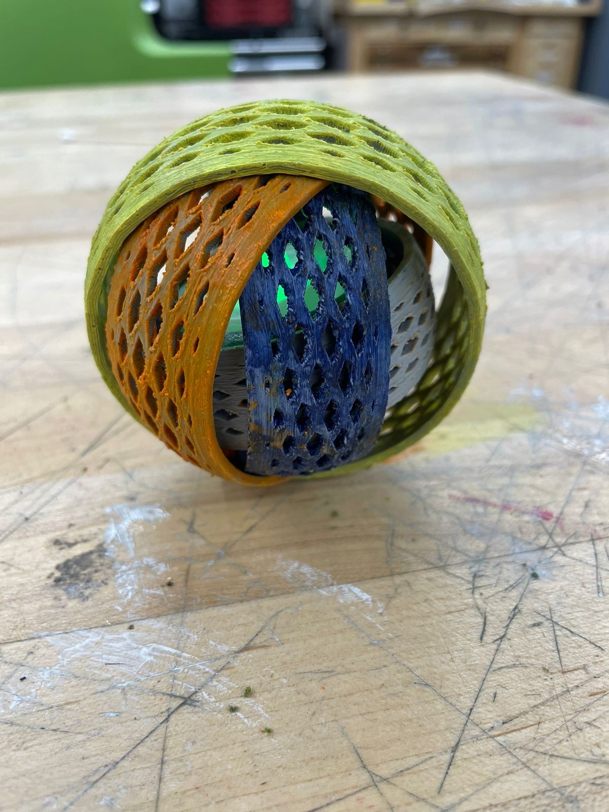

# Automated Lampshade

Lampshade and vase models generated with code in Blender, then 3D-printed. A Python script builds the geometry instead of sculpting it by hand, so changing a few values produces a new design ready for any additive manufacturing process.

## Files

| File | Contents |
|---|---|
| `Digital_Manufacturing_2.blend` | Blender source, including the generator script (Scripting tab), which uses `bpy` and NumPy and merges shapes with boolean unions |
| `Vase_v1.stl` | Print-ready mesh exported from the model |
| `Images/` | Photos of the printed and painted pieces |

## Make your own

Open `Vase_v1.stl` in any slicer. To make your own variation, open the `.blend` file, edit and rerun the script in the Scripting tab, then export a new STL.

## License

See [LICENSE](LICENSE).
